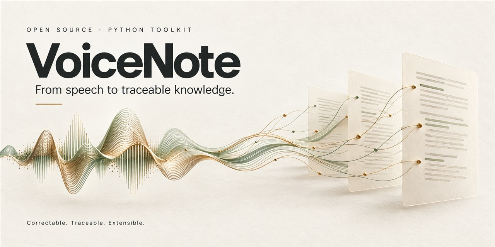

# VoiceNote



[](https://github.com/lynnfeng37-dot/voicenote-toolkit/actions/workflows/ci.yml)
[](https://www.python.org/)
[](LICENSE)
[](#project-status)

**A correctable, traceable, and extensible speech-to-knowledge toolkit.**

Turn recordings into transcripts, auditable corrections, notes, and finance meeting minutes
with a Python library and CLI. Keep the original transcript and follow citations back to it.

[Try without an API key](#try-without-an-api-key) · [Install](#installation) ·
[Python API](#python-api) · [Roadmap](docs/roadmap.md) · [中文说明](README.zh-CN.md)

```bash
python -m pip install -e .
python examples/offline_correction_demo.py
```

Run these commands from a source checkout. The example uses synthetic text and hand-authored
proposals to demonstrate the correction policy and saved audit, without downloading models.

```text
Audio
  └─ Raw Transcript
       └─ Corrected Transcript + Correction Audit
            └─ Source-linked Semantic IR
                 └─ Clean Notes
                      └─ Finance Meeting Minutes
                           └─ Executive Brief
```

Every completed stage remains available. Later outputs never replace the evidence they came from.

> VoiceNote is pre-alpha. The core workflow is implemented and tested, but public APIs may change
> before the first stable release.

## Why VoiceNote?

VoiceNote keeps the evidence chain visible while turning speech into readable documents.

- **Correctable** — ASR changes carry source spans, confidence, reasons, evidence, and decisions.
- **Traceable** — semantic items, note sections, minutes, and brief points retain source segment IDs.
- **Extensible** — transcription, correction, reasoning, renderers, and domain skills are separate.
- **Validated references** — stale spans, conflicting edits, missing required citations, and
  unknown source IDs are rejected locally.
- **Privacy-conscious** — providers and network permissions must be selected explicitly.

Sensitive entities such as names, companies, dates, percentages, monetary values, ticker symbols,
valuation multiples, and financial metrics use stricter correction thresholds.

Citation validation checks whether a source ID exists; it does not prove that the source supports
every generated statement. Review generated notes against the transcript. See
[current limitations and priorities](docs/roadmap.md).

## Features

- Local transcription with `faster-whisper`
- OpenAI transcription with timestamp and optional speaker-segment support
- Schema-constrained transcript correction
- Deterministic correction confidence policy and Markdown audit
- Batched, source-grounded Semantic IR extraction
- Adaptive clean notes without a rigid universal template
- Finance Meeting Skill for research, portfolio, strategy, roadshow, and investment meetings
- Per-point cited executive briefs
- JSON and Markdown artifacts
- Python API, CLI, and thin Codex/Agent Skill
- Mockable provider interfaces and CI-tested Python 3.11/3.12 support

## Installation

VoiceNote is not yet published to PyPI. Install it from source:

```bash
git clone https://github.com/lynnfeng37-dot/voicenote-toolkit.git
cd voicenote-toolkit
python -m venv .venv
```

Activate the environment:

```bash
# macOS / Linux
source .venv/bin/activate

# Windows PowerShell
.venv\Scripts\Activate.ps1
```

Install only the providers you need:

```bash
# Core package
python -m pip install -e .

# OpenAI providers
python -m pip install -e ".[openai]"

# Local faster-whisper transcription
python -m pip install -e ".[local-asr]"

# Development tools
python -m pip install -e ".[dev]"
```

## Quick start

### Try without an API key

After installing the core package, run:

```bash
python examples/offline_correction_demo.py
```

The demo runs the real correction policy and artifact writer on a synthetic example:

| Source text | Proposal | Result |
| --- | --- | --- |
| `Sharp ratio` | `Sharpe ratio`, confidence 0.97 | Applied and recorded |
| `15%` | `50%`, confidence 0.80, sensitive | Original retained; uncertainty recorded |

Open the generated `output/offline-demo/<run-id>/corrections.md` to inspect the audit.
These hand-authored proposals illustrate behavior; they are not model-quality measurements.

### 1. Transcribe locally

Install the `local-asr` extra first. The following multiline commands use Bash syntax;
in PowerShell, put each command on one line or use a backtick for line continuation.

```bash
voicenote meeting.m4a \
  --provider local_whisper \
  --allow-model-download \
  --until transcript
```

Model downloads are disabled by default. After the weights are cached, omit
`--allow-model-download` to keep the run offline.

### 2. Generate corrected notes

For this example, install both extras with `python -m pip install -e ".[local-asr,openai]"`.
Set an API key in your environment, then explicitly authorize cloud processing:

```bash
export OPENAI_API_KEY="..."  # macOS / Linux
# $env:OPENAI_API_KEY="..."  # Windows PowerShell

voicenote meeting.m4a \
  --provider local_whisper \
  --correction-provider openai \
  --reasoning-provider openai \
  --allow-cloud \
  --until notes
```

With this configuration, audio transcription stays local. Raw transcript text goes to the
correction provider; corrected text and Semantic IR go to the reasoning provider.

### 3. Run the complete finance workflow

```bash
voicenote investment-meeting.m4a \
  --provider local_whisper \
  --correction-provider openai \
  --reasoning-provider openai \
  --skill finance_meeting \
  --allow-cloud \
  --until brief \
  --output both
```

The command prints a new run directory containing the available stage artifacts:

```text
output/<run-id>/
├── manifest.json
├── raw_transcript.json
├── corrected_transcript.json
├── corrections.json
├── corrections.md
├── semantic_document.json
├── notes.json
├── notes.md
├── meeting_minutes.json
├── meeting_minutes.md
├── executive_brief.json
├── executive_brief.md
├── result.json
└── result.md
```

The source recording is not copied into the output directory.

## Python API

```python
from voicenote import VoiceNote
from voicenote.config import VoiceNoteConfig

config = VoiceNoteConfig(
    transcription_provider="local_whisper",
    correction_provider="openai",
    reasoning_provider="openai",
    allow_cloud_processing=True,
)

result = VoiceNote("investment-meeting.m4a", config=config).process(
    until="brief",
    skill="finance_meeting",
)

print(result.raw_transcript)
print(result.corrected_transcript)
print(result.notes)
print(result.meeting_minutes)
print(result.executive_brief)
```

For deterministic tests or transcription-only workflows, use `correction_provider="none"`.

## Choose a stopping level

| `--until` | Output | Typical use |
| --- | --- | --- |
| `transcript` | Faithful ASR segments | Archival or downstream processing |
| `corrected` | Corrected transcript and audit | Review-sensitive transcription |
| `notes` | Semantic IR and readable notes | General meeting notes |
| `minutes` | Domain-organized minutes | Professional finance documentation |
| `brief` | Highly compressed cited brief | Executive review and follow-up |

## Correction policy

| Confidence | Default result |
| --- | --- |
| High | Apply automatically and record the change |
| Medium | Apply and flag it for review |
| Low | Retain the original and mark it uncertain |

The model proposes exact source text and an occurrence index—not trusted character offsets.
VoiceNote anchors each proposal locally, checks for conflicts, applies stricter sensitive-entity
thresholds, and records the final decision. See [the provider design](docs/providers.md).

## Finance Meeting Skill

The first official domain skill supports:

- fund manager and portfolio reviews
- company research interviews
- internal investment meetings
- roadshows and strategy discussions
- market, sector, company, valuation, catalyst, risk, decision, and action-item fields

It classifies the meeting before choosing a structure, omits unsupported sections, preserves
qualifications and attribution, and validates every citation against the Semantic IR. It does not
force all meetings into one template.

See [the skill design](docs/skills.md) and
[`src/voicenote/skills/finance_meeting`](src/voicenote/skills/finance_meeting).

## Provider boundaries

| Capability | Built-in provider | Data boundary |
| --- | --- | --- |
| Transcription | `local_whisper` | Local; optional model download |
| Transcription | `openai` | Audio is sent only with explicit cloud consent |
| Correction | `openai` | Transcript text and selected references |
| Correction | `none` | No external call |
| Semantic extraction and organization | `openai` | Corrected text and structured IR |

Importing VoiceNote never inspects API keys, contacts a service, or downloads a model. The presence
of `OPENAI_API_KEY` does not itself authorize an upload.

## Architecture

```text
src/voicenote/
├── core/          immutable schemas and deterministic validation
├── providers/     transcription, correction, and reasoning adapters
├── skills/        domain-specific understanding and organization
└── renderers/     JSON and Markdown presentation
```

The core package does not depend on a web API. New providers and skills can target stable,
provider-neutral schemas instead of duplicating the pipeline.

Further reading:

- [Architecture](docs/architecture.md)
- [Provider design](docs/providers.md)
- [Domain skills](docs/skills.md)
- [Privacy model](docs/privacy.md)
- [Evaluation strategy](docs/evaluation.md)

## Privacy

- Source audio is never uploaded unless the selected transcription provider requires it and cloud
  processing was explicitly authorized.
- Local model download permission is separate from cloud-processing permission.
- Transcript bodies, prompts, provider payloads, and secrets are not logged by default.
- Generated artifacts are written to a fresh run directory; prior runs are not overwritten.
- Redaction is intentionally separate from the immutable source transcript.

Review [the privacy model](docs/privacy.md) before processing confidential or market-sensitive
recordings.

## Development

```bash
python -m pip install -e ".[dev]"
python -m pytest --cov=voicenote --cov-report=term-missing
python -m ruff check .
python -m mypy src/voicenote
```

The current test suite uses fake providers; it does not upload recordings or call live model APIs.

## Project status

Implemented:

- package architecture and provider contracts
- local and OpenAI transcription adapters
- auditable correction and sensitive-entity policy
- source-linked Semantic IR and clean notes
- Finance Meeting minutes and executive brief
- JSON/Markdown artifacts, CLI, Python API, tests, CI, and Agent Skill

Planned after the MVP:

- richer golden evaluation runner
- stable plugin registration API
- REST API
- additional community domain skills
- diarization UX, HTML/DOCX export, and real-time workflows

See [the prioritized roadmap](docs/roadmap.md) for acceptance criteria and known limits.

## Contributing

Contributions are welcome. Start with [CONTRIBUTING.md](CONTRIBUTING.md), keep provider boundaries
explicit, and add provenance-focused tests for new transformations.

## License

VoiceNote is available under the [Apache License 2.0](LICENSE).
